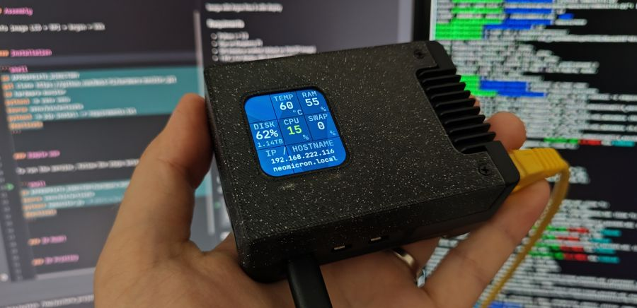
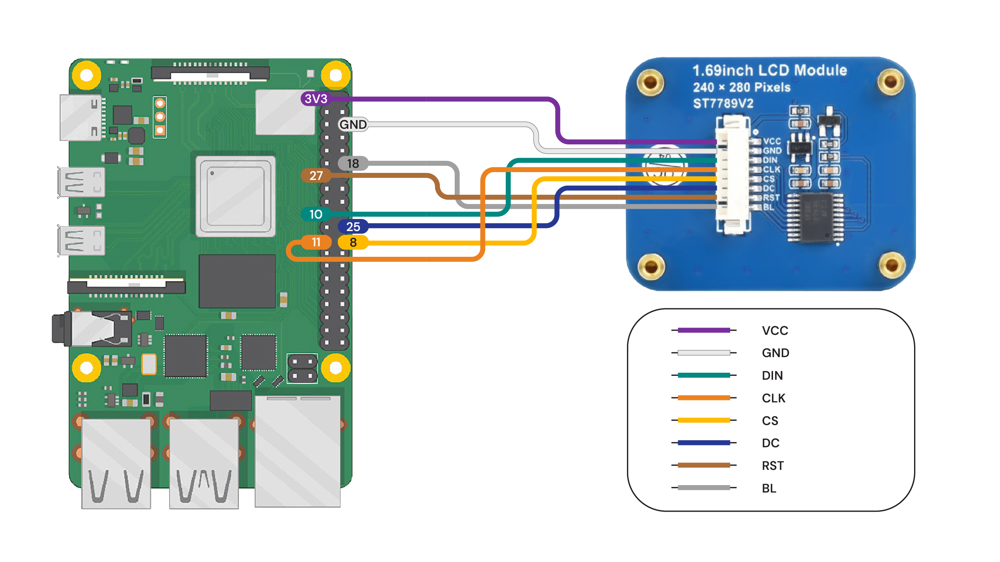
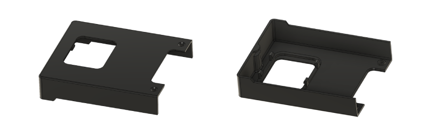
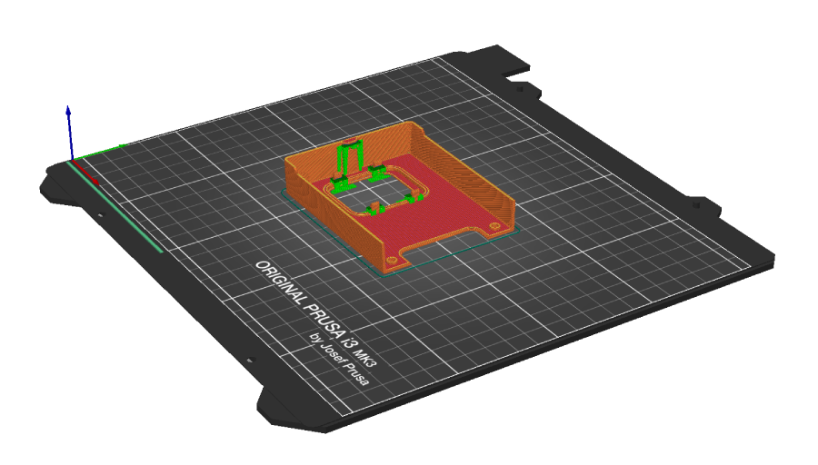

# Web3 Pi Dashboard — Python LCD Application

This repository's **`main` branch** contains the Python Web3 Pi dashboard,
launched by [`hwmonitor.py`](hwmonitor.py) and managed as **`w3p_hwm.service`**.
It shows Raspberry Pi system metrics, Web3 Pi installation progress and
Ethereum client status from the original InfluxDB integration.

For the Rust LCD application used by **Web3 Pi vOS**, see
[Web3-Pi/web3-pi-lcd](https://github.com/Web3-Pi/web3-pi-lcd). That project
builds the `w3p-hwm` binary and uses `w3p-hwm.service`. The `rust` and
`Web3-Pi-vOS` branches here contain earlier Rust development; the instructions
below apply to the Python implementation on `main`.

The display fits the Argon Neo 5 enclosure using the included printable cover.
The open hardware files, wiring guide and application source can be adapted
for other builds.

<p align="center">
  
</p>

## Requirements

- Python >= 3.11
- Raspberry Pi with Linux, SPI/GPIO access and systemd for service installation
- [SPI interface enabled](docs/EnableSPI.md) before starting the display
- 1.69" LCD display with ST7789V2 Driver
  - Waveshare 24382 - [product page](https://www.waveshare.com/1.69inch-lcd-module.htm)
  - Seeed Studio 104990802 - [product page](https://www.seeedstudio.com/1-69inch-240-280-Resolution-IPS-LCD-Display-Module-p-5755.html)
- (Optional) 3D printed model of Argon Neo 5 cover
- (Optional) Argon Neo 5 enclosure

The original Web3 Pi installation log and InfluxDB data are required for
the installation and Ethereum-client status views described below.

## Assembly

### 1. Connect wires
Connect the display to the Raspberry Pi according to the diagram below.  
The colors of the cables may vary depending on the supplier and batch. Focus on the function and pin number, not the color.


Diagram is valid for Raspberry Pi 4 and Pi 5

If on Raspberry Pi 5 your LCD backlight is flickering connect `BL` to `3.3V PIN 17`

### 2. Mount display module

Mount the display in the printed enclosure cover. The display is held in place by four clips. Make sure all 3D printing support residues are removed and the surface to which the display adheres is flat. Install the display by sliding one side under the clips first, then pressing the other side down. Do not use excessive force to avoid damaging the display. The display should fit in easily.

Since each 3D printer may be calibrated differently, it may be necessary to adjust the scale of the 3D model in the slicer software before printing. Our prints are done on [Original Prusa i3 MK3S+](https://www.prusa3d.com/pl/produkt/drukarka-3d-original-prusa-i3-mk3s-3/).

### 3. Mount enclosure cover

Mount the enclosure cover and secure it with two screws. Make sure to arrange the cables inside the enclosure so they do not obstruct the fan and minimize interference with cooling.


## Installation

Enable SPI using the [SPI guide](docs/EnableSPI.md) and reboot if you changed
the boot configuration. On a Debian-based Raspberry Pi system, install the
launcher prerequisites and clone `main`:

```shell
sudo apt-get update
sudo apt-get install git python3-venv python3-pip

git clone --branch main https://github.com/Web3-Pi/web3-pi-dashboard.git
cd web3-pi-dashboard
chmod +x run.sh create_service.sh remove_service.sh
```

[`run.sh`](run.sh) creates `venv/` in the checkout, installs
[`requirements.txt`](requirements.txt), then runs `hwmonitor.py`. It installs
the Python packages on each launch, so allow network access for dependency
resolution. It does not install the OS prerequisites itself.

Keep this checkout at its installation path. The generated service points
to its `run.sh`; fonts and images are loaded from `font/` and `img/`. This
Python launcher does not use the Rust project's single-binary installer.

### Run as a service

From the repository root:

```shell
sudo ./create_service.sh
```

The helper creates `/etc/systemd/system/w3p_hwm.service`, enables it at boot
and starts it. It refuses to create a unit that already exists. After changing
Python source or configuration, restart the existing service:

```shell
sudo systemctl restart w3p_hwm.service
sudo systemctl status w3p_hwm.service
```

View logs with `sudo journalctl -u w3p_hwm.service -f`. To stop it, run
`sudo systemctl stop w3p_hwm.service`. To remove the service, run
`sudo ./remove_service.sh` from the checkout; the helper stops/disables the
unit and removes its systemd file, while keeping the source and local assets.

### Run in the foreground

Use one display process at a time. If the service is installed, stop it first:

```shell
sudo systemctl stop w3p_hwm.service
sudo ./run.sh
```

On a fresh checkout with no service installed, run only `sudo ./run.sh`.
Press **Ctrl+C** to stop. The application needs access to the Raspberry Pi's
SPI and GPIO devices.

## Data Sources and Configuration

| Display data | Source in this branch |
|---|---|
| CPU, temperature, RAM, swap, disk and network metrics | Local readings in `hwmonitor.py` |
| Installation progress | Last JSON line in `/opt/web3pi/status.jlog` |
| EXEC / NODE / CONS status | InfluxDB queries in `db/InfluxDBConnection.py` |
| Fonts, background and animation frames | `font/` and `img/` in this checkout |

The normal dashboard is shown when the installation log reports **`stage: 100`**.
A missing or unreadable log does not mean installation is complete; the program
keeps the installation state unresolved. Check this integration when adapting
the application to a system that does not produce the original Web3 Pi log.

The InfluxDB integration reads `active_percent` from `status_exec`,
`status_node` and `status_consensus`, filtered by a `host` tag ending in `_s`.
Connection settings and polling intervals are in
[`hwmonitor.py`](hwmonitor.py), with queries in
[`db/InfluxDBConnection.py`](db/InfluxDBConnection.py). The current constructor
passes the Raspberry Pi's hostname as both the database host and the basis
of the tag filter; editing the separate `host` constant alone will not change
that call. Review both when using a different database host or data schema.

The display driver uses SPI0 CE0 (`/dev/spidev0.0`) with BCM GPIO **27 RST,
25 DC and 18 BL**, configured in [`lcd/lcdconfig.py`](lcd/lcdconfig.py).

## Customisation

In [`hwmonitor.py`](hwmonitor.py), there is a flag `SHOW_PER_CORE` that determines whether the CPU usage percentage should be in the range of `0-100%` or `0-400%`.

0-400% represents the summed load of each core in the Raspberry Pi.

```python
# Choose how to display CPU usage percentages
SHOW_PER_CORE = False
# False = [0 - 100%]
# True  = [0 - 400%]
```

Restart the service after changing this Python setting:

```shell
sudo systemctl restart w3p_hwm.service
```


## 3D Model

The models are free, so anyone can print them on a 3D printer.



Download the [3D model files](docs/3D_Model).

## 3D Printing

We recommend printing with [PETG](https://botland.store/849-petg-filaments?manufacturers=devil-design,prusa&weight=1000-g&material=petg&diameter=1-75-mm) filament due to the high operating temperatures of the Raspberry Pi.  
To ensure the snap-fits print correctly, enable 'supports everywhere.'  
Use a 0.4 mm nozzle.  
0.2 mm layer height or smaller.  
Our models are printed on [Original Prusa i3 MK3S+](https://www.prusa3d.com/pl/produkt/drukarka-3d-original-prusa-i3-mk3s-3/)

If you do not have access to a 3D printer, you can order an online print from one of the providers such as [JLC3DP](https://jlc3dp.com/3d-printing-quote).   
The original print notes list these process/material options:

- FDM - ABS, ASA or PA12-CF
- MJF - PA16-HP Nylon
- SLS - 3201PA-F Nylon



## Releases and License

The [release workflow](.github/workflows/release.yml) runs for `v*` tags and
packages the Python application with Nuitka on an ARM runner. Its ZIP contains
`hwmonitor` together with `font/` and `img/`; keep those asset directories next
to the executable and run it from that directory.

See [LICENSE](LICENSE) for the project license. Bundled components retain
their own license notices.
